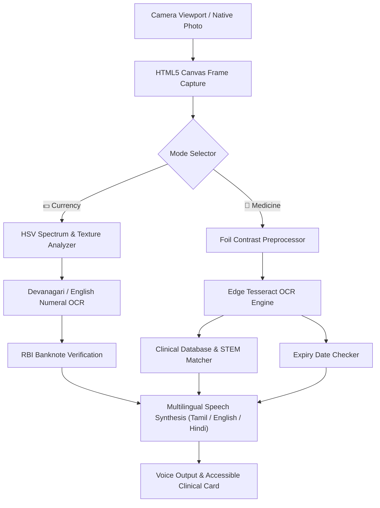

# 👁️ DRISHTI-SETU (பார்வை பாலம்)
### *Universal Offline-First Edge-AI Medicine & Currency Assistant for the Visually Impaired*

[](https://sevafirst.mic.gov.in/)
[](https://sevafirst.mic.gov.in/institute/submissions/10281/submit)
[]()
[]()
[]()

---

## 📌 Project Overview
**DRISHTI-SETU (பார்வை பாலம் - Bridge of Vision)** is an ultra-lightweight, zero-cost, assistive Edge-AI web application designed to empower visually impaired, elderly, and rural citizens across India.

Running **100% inside the browser on device (client-side)**, it requires **zero external hardware sensors, zero specialized smart glasses, and zero ongoing cloud subscription fees**. It works completely **offline** in remote areas without internet connectivity.

### 🎯 Key Capabilities:
1. **💵 RBI Banknote Recognition Engine (₹10 to ₹500):**
   - Instant dual-engine recognition combining high-speed HSV color spectrum analysis and high-tolerance Devanagari/English numeral OCR.
   - Detects ₹10 (Chocolate Brown), ₹20 (Greenish Yellow), ₹50 (Fluorescent Blue), ₹100 (Lavender Purple), ₹200 (Bright Orange), and ₹500 (Stone Grey).
   - Announces denomination and motif details via local speech synthesis in under 200ms.

2. **💊 Comprehensive Clinical Medicine & Safety Scanner:**
   - 50+ essential Indian formulations mapped with exact uses, dosage instructions, and precautions in Tamil, English, and Hindi.
   - Pharmacological STEM engine (e.g., `-sartan`, `-prazole`, `-statin`, `-gliptin`, `-floxacin`, `-cillin`, `-mycin`, `-olol`).
   - High-contrast OCR preprocessing for shiny blister foils.
   - Automatic Expiry Date Extraction (`EXP MM/YY`) with high-priority audio alert: *"எச்சரிக்கை! மாத்திரை காலாவதியாகிவிட்டது! (WARNING! MEDICINE EXPIRED!)"*.

3. **🗣️ Multilingual Audio Guidance:**
   - Native voice output in **Tamil (தமிழ்)**, **English (India)**, and **Hindi (हिंदी)**.
   - Audio earcons, haptic cues, and high-contrast accessibility interface.

4. **📸 Dual Camera & Direct Capture Support:**
   - Real-time WebRTC back camera stream with targeting viewfinder.
   - Native HTML5 Camera Capture fallback (`capture="environment"`) for 100% mobile browser compatibility.
   - Instant 1-click test sample pills for rapid verification and demonstrations.

---

## 🛠️ Architecture & Tech Stack



* **Frontend:** Semantic HTML5, Vanilla CSS3 (Custom Accessible Variables & High Contrast), Modern JavaScript (ES6+).
* **Edge Intelligence:** Tesseract.js (Client-side WebAssembly OCR), Canvas 2D HSV Spectrum Engine, Pharmacological Regex STEM Matcher.
* **Voice & Audio:** Web Speech Synthesis API (`ta-IN`, `en-IN`, `hi-IN`), Web Audio API tone generator for accessibility cues.
* **PWA & Offline:** Service Worker API, Web App Manifest, Cache API.
* **Backend (Local Delivery):** Node.js native HTTP server (`server.js`) with zero external runtime dependencies.

---

## 📁 Repository Structure

```
drishti-setu/
├── index.html       # Primary Accessible Web Application Interface
├── app.js           # Real-Time Edge AI, Currency & Clinical Logic, TTS
├── style.css        # Accessible High-Contrast UI Styling
├── manifest.json    # Progressive Web App (PWA) Manifest Configuration
├── icon.svg         # Application Vector Branding
├── sw.js            # Offline Caching Service Worker
├── server.js        # Lightweight Node.js Static Server
├── launch.bat       # 1-Click Launch Script for Windows
└── README.md        # Documentation and Setup Guide
```

---

## 🚀 Getting Started

### Prerequisites
* Any modern web browser (Google Chrome, Microsoft Edge, Safari, Firefox).
* Node.js (v16+) installed (optional, for local server).

### Running Locally
1. Clone this repository:
   ```bash
   git clone https://github.com/<your-username>/drishti-setu.git
   cd drishti-setu
   ```

2. Start the local server:
   ```bash
   node server.js
   ```
   *(Or on Windows, simply double-click `launch.bat`!)*

3. Open your browser and navigate to:
   ```
   http://localhost:3000
   ```

*(Alternatively, you can directly open `index.html` in your browser without any server).*

---

## 🏆 Challenge Details
* **Competition:** Seva First Innovation Challenge (SFIC 2026)
* **Organized By:** Ministry of Education Innovation Cell (MIC), AICTE, Govt. of India
* **Theme:** Theme 3 — Swasth & Samavesh Bharat (Health & Inclusive India)
* **Sub-Theme:** Assistive Technology & Inclusive Solutions
* **Track:** Track A (Product & Technology / Software)

---

## 📜 License
Developed for the **Seva First Innovation Challenge (SFIC 2026)**. Released under the MIT License.
